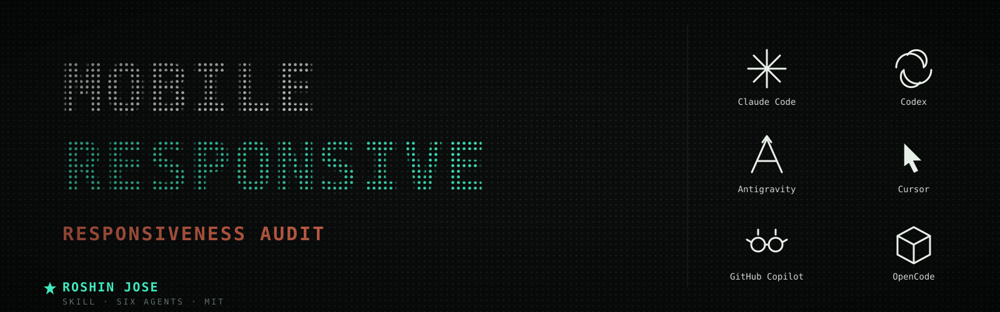

<p align="center">
  
</p>

# Mobile Responsiveness

Systematic mobile-responsiveness audit for websites, apps, dashboards, landing pages, and HubSpot/WordPress themes. Use when the user asks to "check m

**Author:** Roshin Jose · roshinjose1@gmail.com

A cross-tool AI agent skill. Works in Claude Code, OpenAI Codex, Google Antigravity, Cursor, GitHub Copilot, and OpenCode.

## Install (Claude Code)
```bash
git clone https://github.com/Roshinjose167/Awesome-Mobile-Responsiveness-Skill.git
cp -R Awesome-Mobile-Responsiveness-Skill/ ~/.claude/skills/mobile-responsiveness/
```
An agent loads the skill when the task matches its description, or invoke it by name.

## License
[MIT](LICENSE) © 2026 Roshin Jose.
